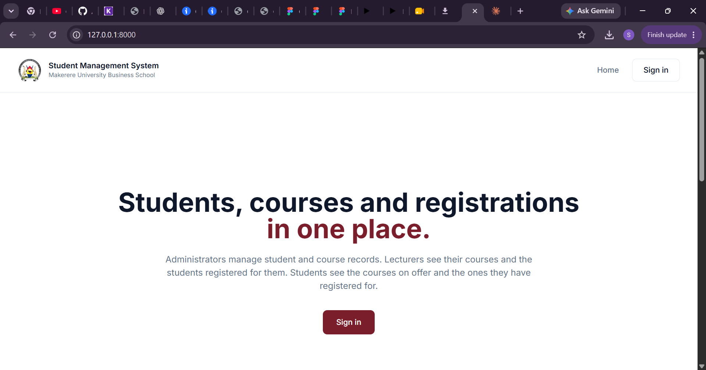
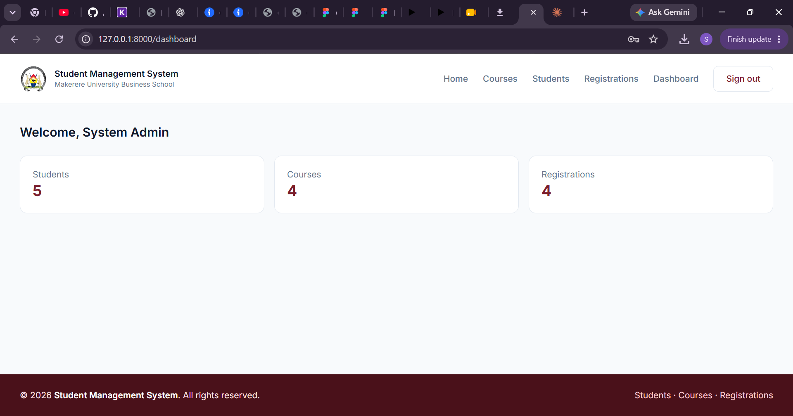
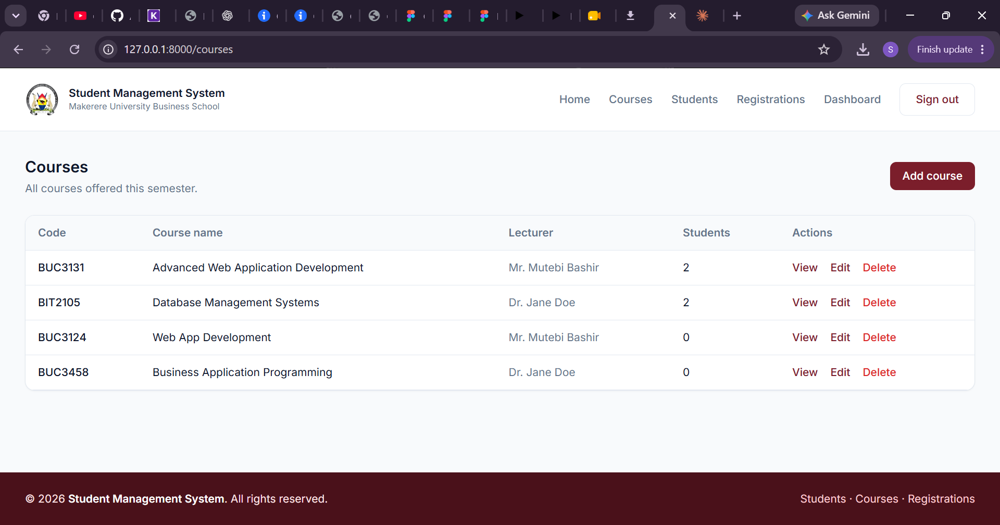
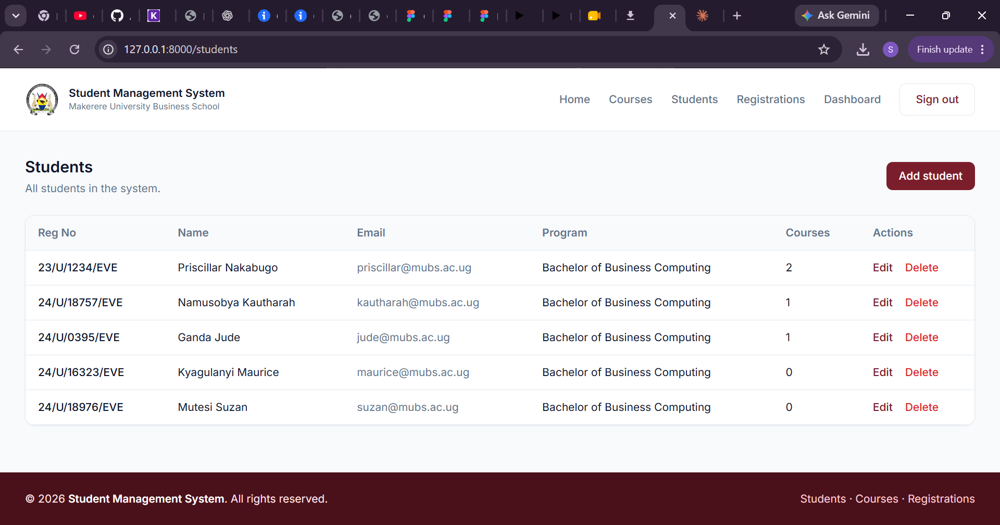
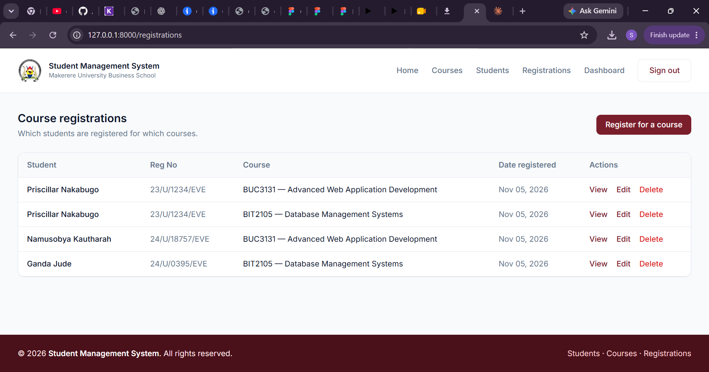
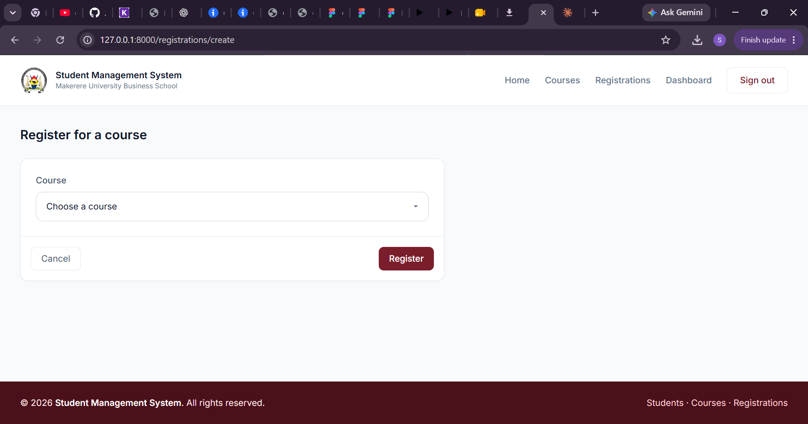

# Student Management System

A Laravel web application for managing students, courses, lecturers and course registrations.
Built for Advanced Web Application Development (BUC3131), Makerere University Business School.

- **Administrators** manage students, courses, registrations and user access.
- **Lecturers** view their assigned courses and the students registered for them.
- **Students** view available courses, register for courses and see their own registrations.

## Requirements

- PHP 8.3 or newer
- Composer
- SQLite (default) or MySQL (for example through XAMPP)

## Installation

1. Clone the repository and open the folder:
   ```
   git clone https://github.com/AriSasha/DRF-AWAD-CW2.git
   cd DRF-AWAD-CW2
   ```
2. Install the PHP packages:
   ```
   composer install
   ```
3. Create the environment file and the app key:
   ```
   cp .env.example .env
   php artisan key:generate
   ```

## Database setup

**Option A: SQLite (default, no setup needed).** Leave `DB_CONNECTION=sqlite` in `.env`.

**Option B: MySQL.** Create an empty database (for example `student_management` in phpMyAdmin), then set these lines in `.env`:
```
DB_CONNECTION=mysql
DB_HOST=127.0.0.1
DB_PORT=3306
DB_DATABASE=student_management
DB_USERNAME=root
DB_PASSWORD=
```

Then build the tables and add the sample data:
```
php artisan migrate:fresh --seed
```
If it asks to create the SQLite database, type `yes`.

## Running the app

```
php artisan serve
```
Open http://127.0.0.1:8000 and sign in with one of the accounts below.

## User roles and sample logins

All sample accounts use the password **password**.

| Role | Name | Email | What they can do |
| --- | --- | --- | --- |
| Admin | System Admin | admin@mubs.ac.ug | Add, edit and delete students, courses and registrations |
| Lecturer | Mr. Mutebi Bashir | bmutebi@mubs.ac.ug | View his courses and their registered students |
| Lecturer | Dr. Jane Doe | jdoe@mubs.ac.ug | View her courses and their registered students |
| Student | Priscillar Nakabugo | priscillar@mubs.ac.ug | View courses, register, view own registrations |
| Student | Namusobya Kautharah | kautharah@mubs.ac.ug | View courses, register, view own registrations |

Roles and permissions are created by `RolePermissionSeeder` using the Spatie Laravel Permission package:

| Permission | Admin | Lecturer | Student |
| --- | :---: | :---: | :---: |
| manage courses | ✓ | | |
| manage students | ✓ | | |
| manage registrations | ✓ | | |
| view courses | | ✓ | ✓ |
| view registrations | | ✓ | ✓ |
| register for courses | | | ✓ |

## Screenshots








## Team

| Member | Tasks | Branch |
| --- | --- | --- |
| Arinda Sasha | Application functionality (Q4), Blade layouts and views (Q5), documentation (Q6) | feature/blade-layouts, feature/student-management, feature/documentation |
| Buyinza Moureen and Ashaba Karren Alicia | Database design and relationships (Q1), authentication, roles and permissions (Q3) | feature/relationships, feature/roles-permissions |
| Nakalema Christine | Seeders and sample data (Q2) | feature/seeders |
